<p align="center">
  
</p>

<h1 align="center">HPP Studio</h1>

<p align="center">
  Desktop tool for <b>Hybrid Power Plant</b> simulation, sizing optimisation and transient studies<br>
  PV · BESS · Wind (WTG) · Steam (STG) · Gas (GTG) · Diesel (DEG) · Utility Grid
</p>

<p align="center">
  
  
  
  
</p>

<p align="center">
  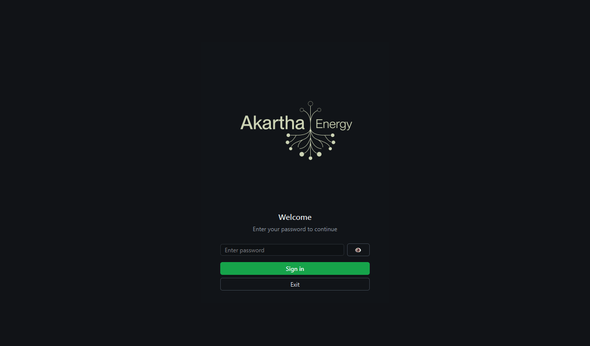
</p>

---

## Features

| Area | What it does |
|---|---|
| **Dispatch simulation** | Hourly or sub-hourly, 1 year (8760/8784 h or up to 1-minute data); configurable load-supply and BESS-charging priorities, interlocks and DEG rules. Matches the reference Excel workbook to ~1e-13. |
| **BESS strategies** | Peak shaving, time-shifting/arbitrage, renewable smoothing, firming, load following, DG minimum loading, spinning reserve, frequency regulation, Q/V control, backup, black start |
| **Sizing optimisation** | Vectorised NumPy + multiprocessing sweep of PV / inverter / BESS, with 9 objectives and constraints. Supports batch multi-site runs. |
| **Finance** | CAPEX, OPEX, LCOE, NPV, IRR, ROI, payback, cash flow; multi-year projection with PV degradation and BESS SOH/replacement |
| **Dashboard** | Interactive time series, energy mix, monthly bars and heatmaps. *Case Analysis Mode* classifies every step by the status of the installed generators. |
| **Transient** | Single-bus RMS studies (generator trip, BESS loss, PV/WTG variability, load step, motor starting, synchronisation, feeder fault, black start). Also covers short circuit and protection, Pass/Fail with evidence per criterion, and Existing / New / Existing + New comparison. |
| **PQA measurements** | Import of power-quality analyser data: sag/swell, frequency & RoCoF, load profiling, unbalance, THD/harmonics. Measured events are matched to simulated cases. |
| **External data** | PVGIS (PV) and ERA5 (wind, via Open-Meteo / Copernicus CDS), with a location picker on a map |
| **Reports & export** | Feasibility report (PDF / Word), transient report (Excel / Word), Excel exports, and a single-line architecture editor (image/PDF import with built-in OCR) |
| **UX** | Indonesian / English UI, dark/light theme, projects saved as a single `.hpps` file (all inputs and results), configurable full-screen chart grid |

## Quick start

```bash
git clone <repo-url> && cd HPPStudio
python -m venv .venv
.venv\Scripts\activate            # Linux/macOS: source .venv/bin/activate
pip install -r requirements.txt
python selftest.py                # optional: engine check without GUI
python set_password.py            # once: set the login password (stored locally)
python main.py
```

The app opens with a password gate. The password hash is kept in `app/config/password_local.py`, which is created by `set_password.py` and ignored by git. Without that file every password is rejected.

On Windows you can also double-click **`run_dev.bat`**. It picks Python 3.10–3.13, creates a venv and starts the app.
PySide6 does not support Python 3.14 yet.

### Build a Windows executable

| Script | Output |
|---|---|
| `build_windows.bat` | `dist\HPPStudio\HPPStudio.exe` (folder, fast start-up) |
| `build_windows_onefile.bat` | single `HPPStudio.exe`, see [`DISTRIBUSI_EXE.md`](DISTRIBUSI_EXE.md) |

## Workflow

1. **Home**: project identity and site location.
2. **Parameters**: generators, BESS, dispatch strategy, finance, constraints.
3. **Data**: import load / PV / grid status / wind / STG–GTG status, or download them from PVGIS and ERA5.
4. **Dashboard**: run the simulation and explore the results.
5. **Optimization** / **Multi-Year**: sizing sweep and long-term projection.
6. **Transient**: dynamic studies, optionally validated against PQA data.
7. **Results**: KPIs, cash flow, Excel export and reports.

## Screenshots

Captured from v23 with the bundled `assets/sample_input.xlsx` (one year, hourly) and default parameters. Figures are illustrative only.

### Login
Password gate shown before the main window.

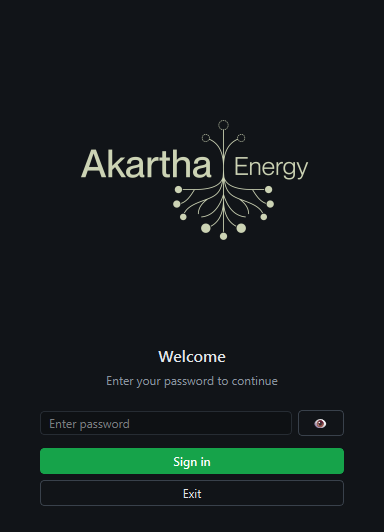

### Home
Project identity, site coordinates (with map picker) and a summary of the loaded data and last simulation.

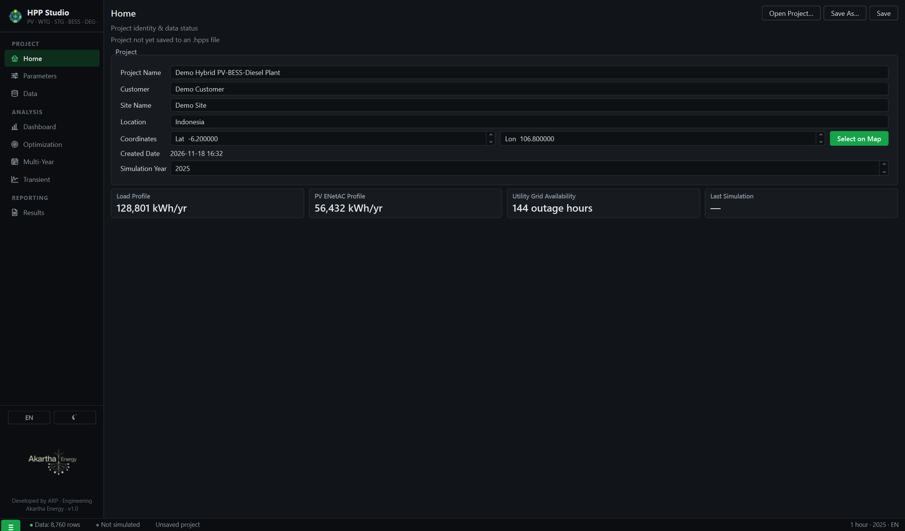

### Parameters
Every system input in one place: utility grid, PV, inverter, BESS, diesel, dispatch strategy and load-supply / charging priorities, finance and constraints.

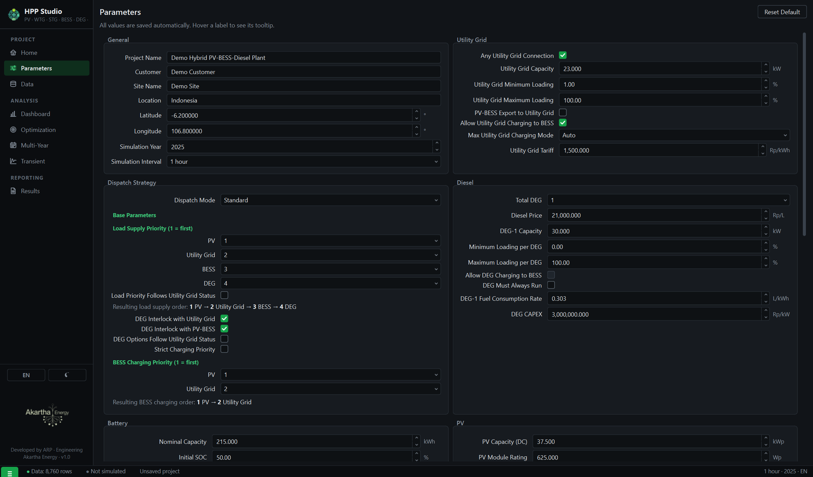

### Data
Import load, PV, grid status and other profiles from Excel/CSV, or download PV from PVGIS and wind from ERA5. Includes a profile preview.

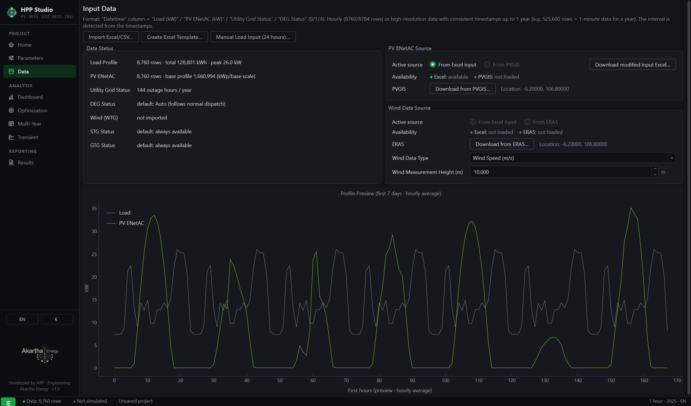

### Dashboard
Runs the dispatch simulation and shows headline KPIs with interactive charts.

| Time series | Advanced (EMS) |
|---|---|
| 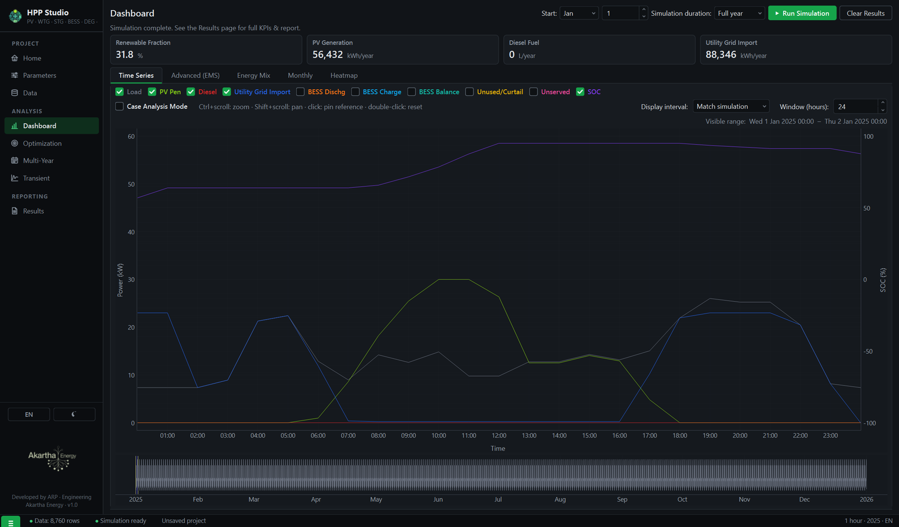 | 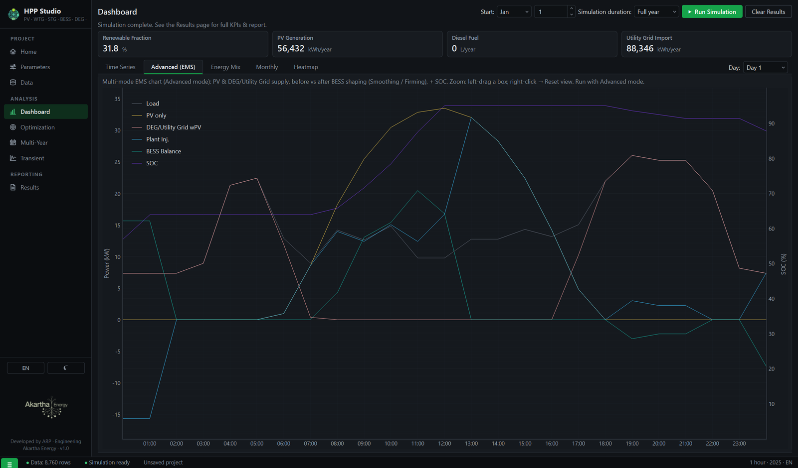 |
| **Energy mix** | **Monthly** |
| 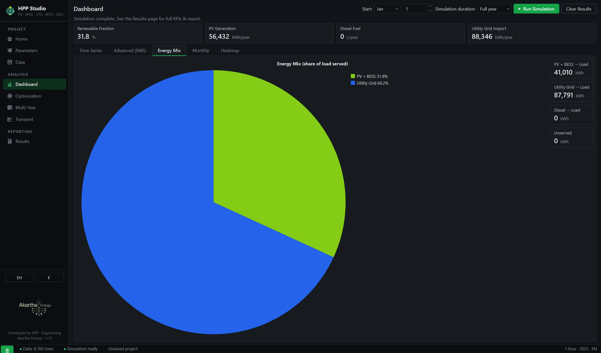 | 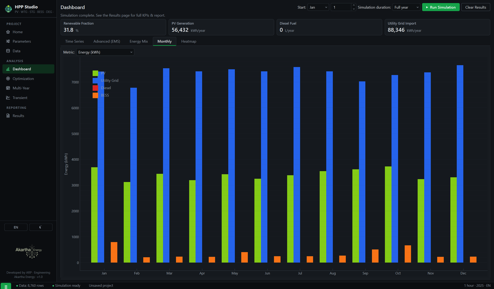 |
| **Heatmap** | **Light theme** |
| 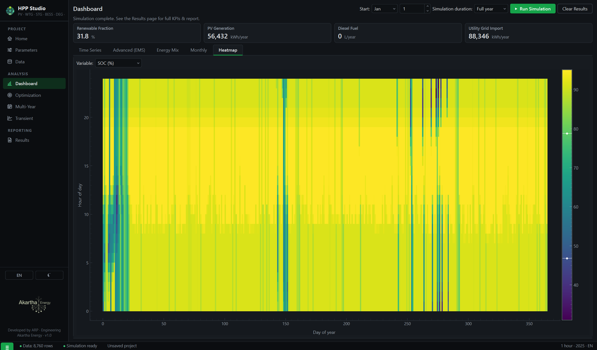 | 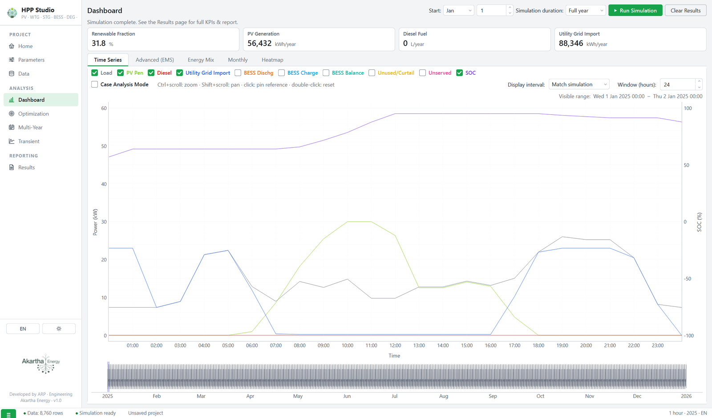 |

### Optimization
Sweep of PV / inverter / BESS sizes with constraints and prioritised objectives. Candidates are ranked, and the best one can be applied back to Parameters.

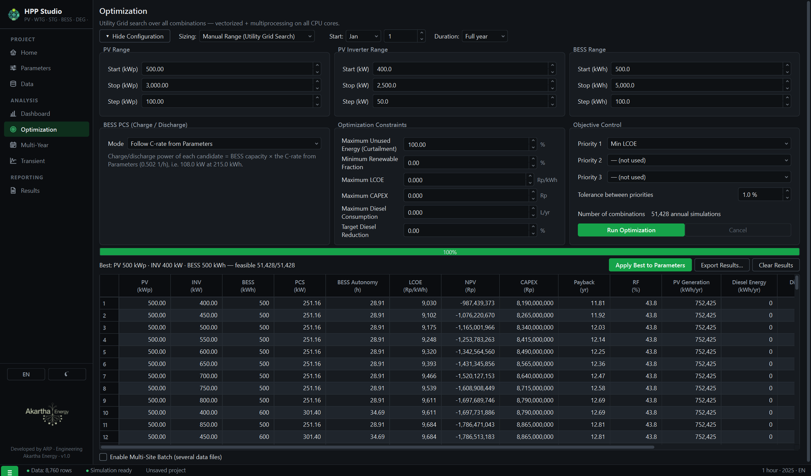

### Multi-Year
Project-lifetime simulation with PV degradation and BESS state of health, giving lifetime LCOE, NPV, IRR and payback plus yearly charts and tables.

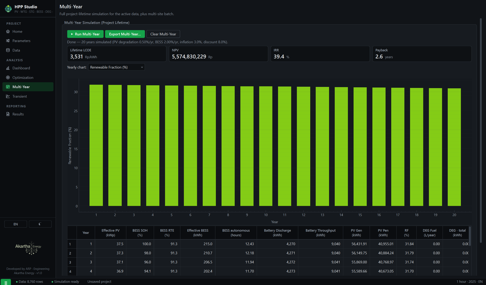

### Transient
Single-bus RMS studies with Pass/Fail evidence per criterion and the standard behind each limit. PQA measurements can be imported for comparison.

| Study setup | Simulation results |
|---|---|
| 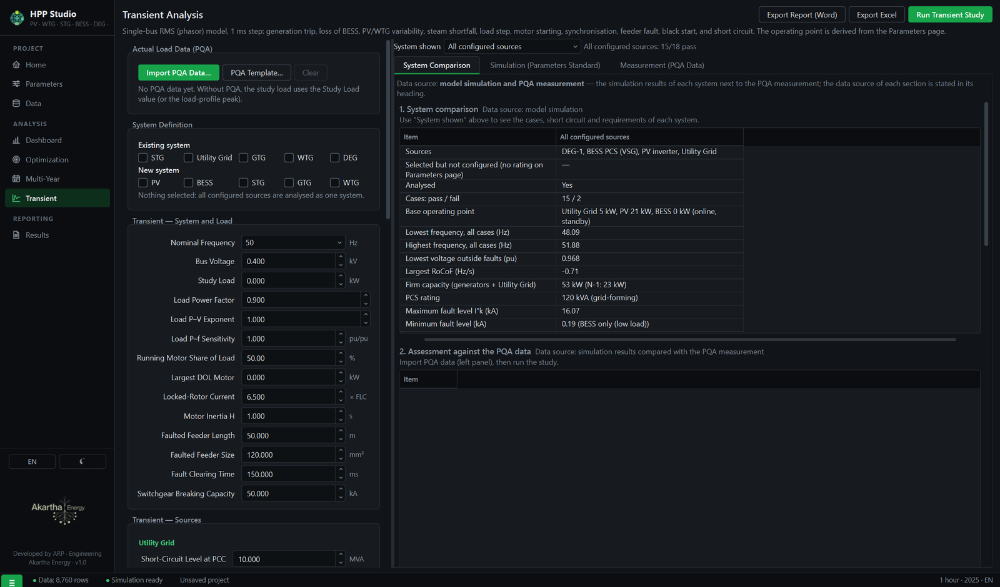 | 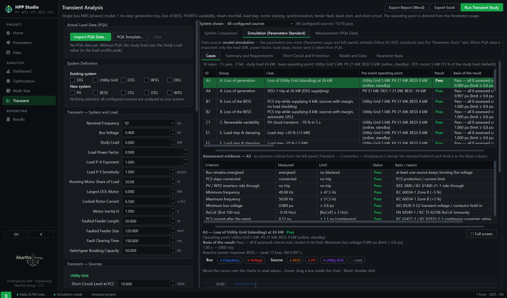 |

### Results
Technical and financial KPIs, cumulative cash flow, Excel export, architecture design and the feasibility-study report.

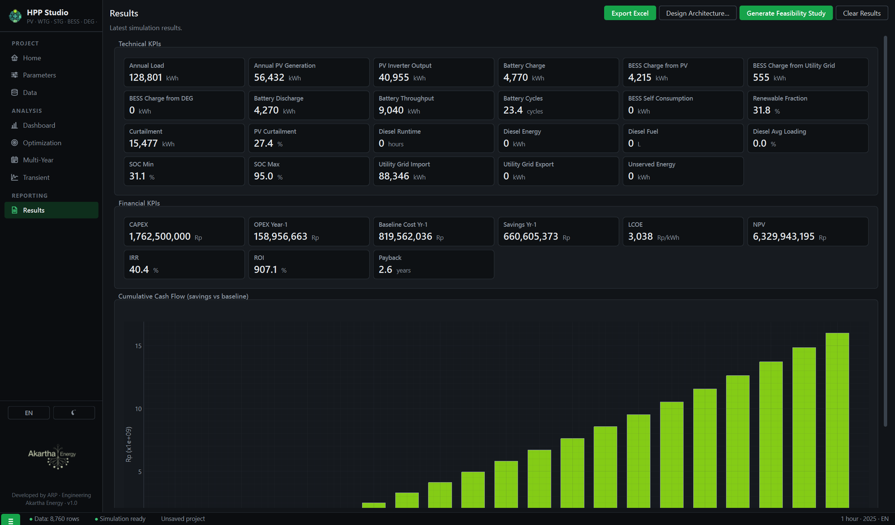

## Input data

One Excel/CSV sheet with a header row. Column names are matched flexibly and are not case-sensitive.

| Column | Required | Notes |
|---|---|---|
| `Datetime` | yes | consistent interval, up to 1 year |
| `Load` (kW) | yes | |
| `PV ENetAC` (kW) | yes* | or download from PVGIS |
| `Utility Grid Status` | no | 1 = available, 0 = outage |
| `DEG Status` | no | 0 / 1 / A (forced off / on / auto) |
| `Wind` | no | m/s or kW; or download from ERA5 |
| `STG Status`, `GTG Status` | no | 1 / 0 |

\* Load and PV may come from separate files. A sample is provided in `assets/sample_input.xlsx`, and the app can generate a template.

## Project layout

```
HPPStudio/
├── main.py                 # entry point
├── selftest.py             # non-GUI end-to-end check
├── app/
│   ├── engine/             # dispatch, KPI, finance, optimisation, multi-year, transient, cases
│   ├── data/               # importers/exporters, .hpps project files, PVGIS, ERA5, PQA
│   ├── reports/            # PDF/Word/HTML reports, charts, architecture design
│   ├── gui/                # PySide6 pages, theme, widgets, plotting helpers
│   ├── config/             # parameter schema, i18n (ID/EN), settings
│   └── ocr/                # bundled ONNX OCR models
├── assets/                 # icons, logos, sample input
└── docs/                   # engineering basis & standards (WTG/STG/GTG, transient)
```

The engine has no GUI dependency, so you can use it from a plain Python script:

```python
from app.engine.simulation import SimulationEngine
```

## Documentation

- Engineering basis, standards and change notes: [`docs/v162_wtg_stg_transient.md`](docs/v162_wtg_stg_transient.md)
- Dispatch audits: `audit_dispatch*.py`, `cek_dispatch.py`

## License

© Akartha Energi Baru. All rights reserved. <!-- replace with your chosen license -->
